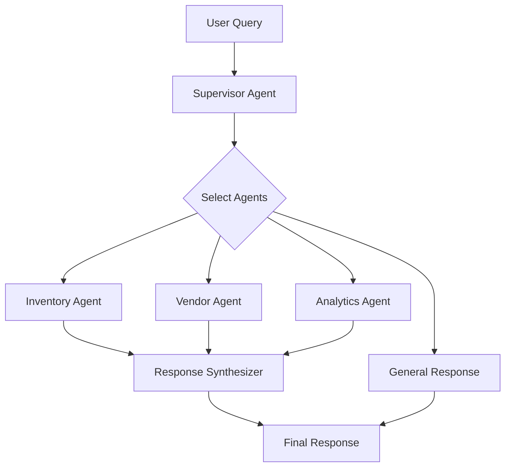
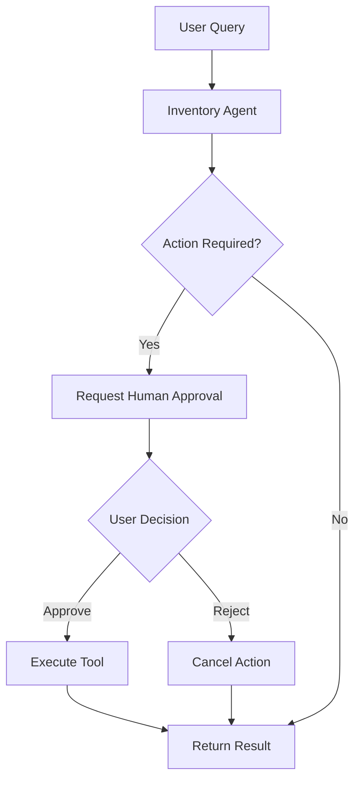

# 📦 Inventory AI Analyst

An AI-powered inventory management assistant built using **LangChain, LangGraph, FastAPI, MongoDB, Ollama, and React**. It uses specialized AI agents to analyze inventory data, generate reports, manage vendor information, and assist with inventory operations through natural language conversations.

## 🚀 Features

- **Multi-Agent System** – Supervisor intelligently routes queries to specialized agents.
- **Inventory Analysis** – Identify low-stock products and analyze inventory levels.
- **Vendor Management** – Retrieve pending deliveries and vendor information.
- **Inventory Reports** – Generate comprehensive reports covering low stock, pending deliveries, and monthly inventory.
- **Human-in-the-Loop (HITL)** – Requires user approval before executing inventory-changing operations.
- **Tool Calling** – AI agents interact with MongoDB through custom tools.
- **Conversation Memory** – Maintains conversation context using LangGraph checkpointing.
- **Natural Language Interface** – Interact with inventory data using everyday language.
- **Dual Agent Modes** – Switch between Multi-Agent and HITL workflows.
- **Interactive Chat UI** – React-based interface with Markdown-rendered AI responses.

## 🛠️ Tech Stack

| Category | Technologies |
|---|---|
| Frontend | React, Vite, JavaScript |
| Backend | Python, FastAPI |
| AI Frameworks | LangChain, LangGraph |
| LLM | Ollama (Qwen3:4b) |
| Database | MongoDB |
| State & Memory | LangGraph SQLite Checkpointer |
| Communication | REST API |

## 🏗️ Architecture

### Multi-Agent Workflow



### Human-in-the-Loop Workflow



## 🤖 Specialized Agents

| Agent | Responsibilities |
|---|---|
| **Supervisor Agent** | Analyzes user queries and selects appropriate specialist agents |
| **Inventory Agent** | Handles inventory levels, low-stock detection, and inventory queries |
| **Vendor Agent** | Retrieves vendor information and pending delivery details |
| **Analytics Agent** | Generates comprehensive inventory reports |
| **Response Synthesizer** | Combines multiple specialist results into a unified response |

## 💡 Example Queries

```text
Show low-stock items
Which vendors have pending deliveries?
Show inventory received this month
Generate a complete inventory report
Show low-stock items and pending deliveries from their vendors
Please reorder 100 units of Router
```

## ⚙️ Setup & Installation

### Prerequisites

- Python 3.11+
- Node.js and npm
- MongoDB
- Ollama

### 1. Clone the Repository

```bash
git clone <your-repository-url>
cd Inventory-AI-Analyst
```

### 2. Set Up Ollama

Install [Ollama](https://ollama.com/) and pull the required model:

```bash
ollama pull qwen3:4b
```

Ensure Ollama is running before starting the backend.

### 3. Set Up the Backend

```bash
cd backend

python -m venv venv
```

Activate the virtual environment.

**Windows PowerShell:**
```powershell
.\venv\Scripts\Activate.ps1
```

Install dependencies:

```bash
pip install -r requirements.txt
```

Start the FastAPI server:

```bash
uvicorn main:app --reload
```

Backend runs at: `http://127.0.0.1:8000`

API documentation: `http://127.0.0.1:8000/docs`

### 4. Set Up the Frontend

Open a new terminal:

```bash
cd frontend

npm install
npm run dev
```

Frontend runs at: `http://localhost:5173`

## 🔐 Human-in-the-Loop Approval

Inventory-changing operations require explicit approval before execution.

Example:

```text
User: Please reorder 100 units of Router

AI: Approval required
    Action: reorder_inventory
    Product: Router
    Quantity: 100

User: Approve

AI: Purchase order created successfully.
    PO Number: PO-39F04B5F
    Vendor: Cisco
    Quantity: 100
    Status: Pending
```

Rejecting the action prevents the inventory modification from executing.

## 📁 Project Structure

```text
Inventory-AI-Analyst/
│
├── backend/
│   ├── agent/
│   │   ├── inventory_agent.py
│   │   ├── vendor_agent.py
│   │   ├── analytics_agent.py
│   │   ├── supervisor_agent.py
│   │   ├── response_synthesizer.py
│   │   ├── multi_agent_state.py
│   │   ├── multi_agent_graph.py
│   │   ├── inventory_hitl_graph.py
│   │   └── inventory_report_workflow.py
│   │
│   ├── tools/
│   │   └── inventory_tools.py
│   │
│   ├── main.py
│   └── requirements.txt
│
├── frontend/
│   ├── src/
│   │   ├── services/
│   │   │   └── api.js
│   │   ├── App.jsx
│   │   └── App.css
│   └── package.json
│
└── README.md
```

## 🔮 Future Enhancements

- Advanced inventory forecasting
- Visual analytics dashboard
- Automated low-stock notifications
- Enhanced vendor performance analysis


Full Stack Developer | AI & Agentic AI Enthusiast
